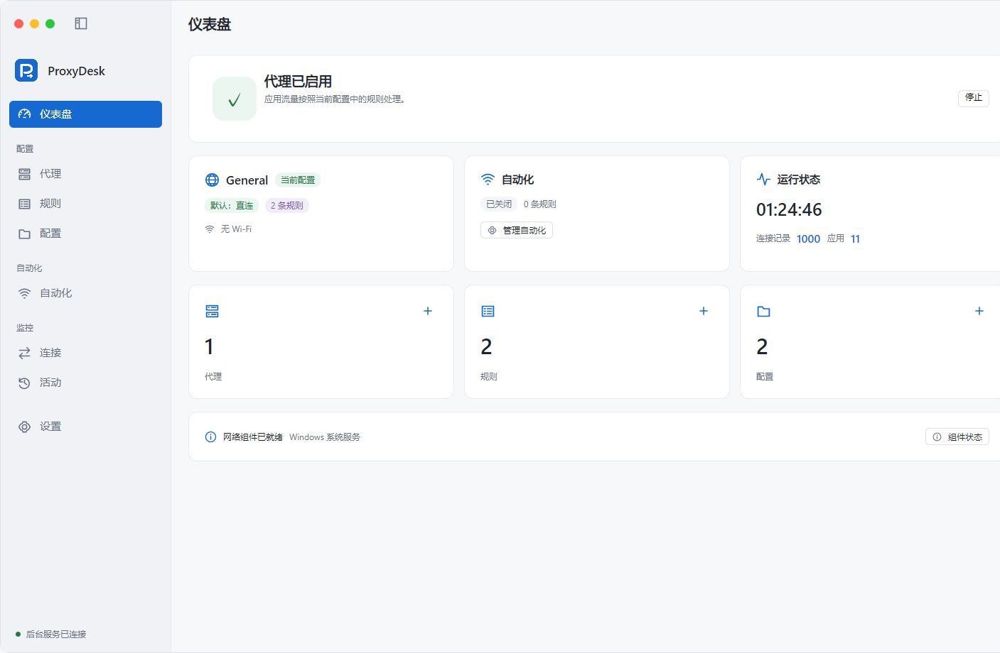

# ProxyDesk

Windows x64 应用代理工具，为不同程序设置代理、直连或阻止规则，支持 SOCKS5、HTTP 和 HTTPS 代理。

## 运行截图

仪表盘展示代理启停状态、当前配置和连接概览。

## 下载与安装

前往 [Releases](https://github.com/welcomelwd/ProxyDesk/releases/latest) 下载最新版本。安装版和便携版均内置运行组件，无需额外安装 .NET。

| 版本 | 使用方式 |
| --- | --- |
| 安装版 `ProxyDesk-Setup-*-x64.exe` | 运行安装程序，确认 Windows 管理员授权，安装后从桌面或开始菜单启动。 |
| 便携版 `ProxyDesk-Portable-*-x64.zip` | 完整解压到当前用户可写的文件夹，双击 `ProxyDesk.exe`。首次独立启动时需要管理员授权。 |

ProxyDesk 不提供代理服务器，需要自行准备可用的代理地址，例如本机代理客户端的监听地址。

## 快速开始

1. 打开“代理”页面，添加代理，填写协议、地址、端口及必要的账号密码，保存后测试连接。
2. 打开“规则”页面，选择需要处理的程序，将动作设为“代理”，再选择刚添加的代理。
3. 在仪表盘启用代理。若出现“授权启动后台”或“授权并启用”，按提示完成 Windows 管理员授权。
4. 正常打开目标程序，在“连接”页面查看规则命中及连接情况；遇到问题时查看“活动”页面。

首次使用的默认配置为直连，添加代理并不会自动让所有程序走代理。

## 设置规则

- **选择程序**：可拖入可执行文件、文件夹、脚本或 Windows 快捷方式，也可从运行中的程序、已安装的程序中选择。
- **选择动作**：代理、直连或阻止。代理动作需要指定代理服务器。
- **调整顺序**：规则从上到下匹配，首条命中的规则生效；更具体的规则放在前面。
- **DNS 解析走代理**：默认开启，使用所选代理访问设置中的 DoH 服务器；关闭后使用系统 DNS，其他连接仍按规则处理。
- **同时应用于派生进程**：默认开启，目标程序启动的子进程及后续派生进程沿用该规则。

脚本请使用“脚本路径”规则，并以完整路径启动；Python `-m` 等模块启动方式不能按脚本文件路径匹配。

## 启动与退出

关闭窗口会缩小到系统托盘。需要停止代理并退出时，在托盘菜单选择“退出并停止代理”。

安装版通过 Windows 后台服务运行；独立运行的便携后台会随退出一同结束。本机已有 ProxyDesk 后台时，便携版会连接现有后台并使用其配置，可在设置页查看实际数据目录。

## 配置备份与更新

在“设置 → 配置备份”中导出或导入配置。备份不包含代理密码，导入后需要重新填写密码；换电脑时还需检查程序路径。

便携版独立运行时，配置保存在程序旁的 `Data` 文件夹。更新前先退出程序，将新版解压到新文件夹，再复制旧版 `Data`。密码与当前 Windows 账户关联，跨电脑或账户迁移请使用配置导出、导入。

## 常见问题

- **无法连接代理**：先测试代理地址、端口、协议及账号密码，确认上游代理本身可用。
- **程序没有命中规则**：检查规则是否启用、程序路径和规则顺序；由启动器打开的程序，可开启派生进程选项。
- **后台未连接或组件不可用**：按界面提示授权启动后台，查看“活动”中的具体错误；组件缺失时重新解压完整便携包或重新安装。
- **需要代理 UDP**：使用支持 UDP ASSOCIATE 的 SOCKS5 代理；HTTP/HTTPS 代理不支持普通 UDP 转发。
- **同时使用 ProxyBridge**：请先停止原版 ProxyBridge 的代理，避免占用相同的转发端口。

更多便携版操作见[便携版使用说明](https://github.com/welcomelwd/ProxyDesk/blob/main/docs/portable.md)。
